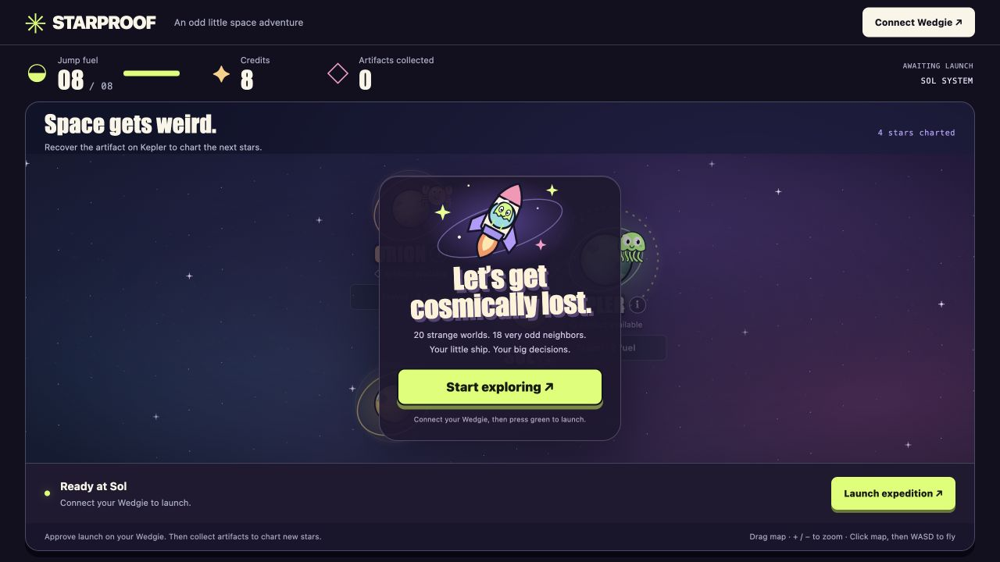

# Starproof

A browser space-exploration reference game for [wedgie-actions](https://github.com/NikolaiL/wedgie-actions), using a Wedgie with an **OPTIGA Trust M** chip. Expedition launch always requires a manufacturer-certified factory-key signature. **Demo admin settings** let you configure whether travel, artifact collection, refuelling and scavenging also require Wedgie confirmation; all four default to on. Flying, scanning and inspecting destinations need no signature.

Submission materials: [hackathon copy](docs/HACKATHON_SUBMISSION.md) · [cover, social image and icons](docs/BRAND_ASSETS.md).

## Screenshots



The browser game starts here; recovered star maps expand the same playing field to 20 planets.

## Run

Requires Node.js 24+ and desktop Chrome or Edge for Web Serial. The signing toolkit and installable device app are pinned to GitHub commits. The browser build bundles Three.js and Wedgie’s real 3D model; esbuild is a development dependency. No GitHub login or SSH key is needed to install dependencies.

```sh
npm ci
npm start
# http://localhost:4173
npm test
npm run build  # browser bundles and pinned device installer
```

Tests also require OpenSSL and Python 3. They create an ephemeral test CA, exercise real P-256 signatures, and verify that the production verifier rejects that software-generated identity. Test trust roots never enter the running app.

## Install the Wedgie app

**Connect Wedgie** checks the installed app. If it is missing or outdated, the browser shows the exact GitHub revision and asks the device to install it. Press the physical green button on Wedgie’s **FULL CONTROL** prompt; red declines. After writing and checking the four app files, it restarts and connects to Starproof. Desktop Chrome/Edge and firmware 0.3.76+ are required.

After installation, the browser waits up to 15 seconds for the same board to report Starproof running. If the restart replaces its USB port, it finds that board among ports already authorized for the game and reconnects without another picker or installation prompt.

The installable app has its own repository: [NikolaiL/wedgie-starproof](https://github.com/NikolaiL/wedgie-starproof). To install through [wedgie.dev/connect](https://wedgie.dev/connect), open **Apps from a GitHub repo**, add **`NikolaiL/wedgie-starproof`**, and install Starproof. Close that USB connection before returning to the game. If wedgie.dev reports “the wedgie didn’t take it,” its current signed-app fallback blocked the community app before copying; use this game’s Connect installer or the CLI instead. The [device repo documents the upstream issue](https://github.com/NikolaiL/wedgie-starproof#install-through-wedgiedev). CLI users can clone the device repository and run the official `wedgie.py install .` there.

The game pins this device repo as `starproof-device` and builds a same-origin bundle containing the exact source files and SHA-256 checksums. Device source is maintained only in that repo. Installation selects Starproof as the running app; the app creates no keys, locks no objects, and never writes Safe Signer’s key slots. Existing factory identity is used as provisioned. Device restart closes installer access.

Only one tab or serial tool can hold the Wedgie USB connection. If the port cannot open, close other wedgie.dev and Starproof tabs (and tools such as `wedgie.py`), unplug and reconnect the device, then try Connect again in one game tab.

## Play

1. Connect Wedgie. The server validates its certificate; this alone is not proof of key possession.
2. Use the central **Start exploring** button and press green on Wedgie. A valid factory-key signature starts the mission.
3. Drag to pan, use +/− for smooth zoom, or **Fit galaxy** to see every known world. Click the map and fly with WASD/arrows; the rocket faces its direction of travel. Space or **Scan** scans the nearest system. Click a planet’s name to center it, or its **(i)** to toggle its report popup. Eighteen monsters across five species react to scans.
4. **Travel** beneath a planet spends **2–8 fuel based on distance** and requires a signature by default. The tank holds 8; short hops preserve fuel, while Sol–Moss consumes a full tank. The chart shows the exact cost before approval.
5. **Refuel** uses one free full-tank cache per planet; later full refills cost **4 in-game credits**. Start with 8 credits; each artifact pays 4, enough for one refill. **Scavenge** gathers up to 2 free fuel per action, so running out of credits cannot strand you. These credits have no real-world value.
6. **Collect artifact +4** beneath your current planet collects its unique loot, with a confetti celebration. Kepler reveals **Nebula Reach**, Lyra **Wild Frontier**, Moss **Aurora Drift**, Cinder **Ember Expanse**, and Borealis **Midnight Verge**. One chart grows in every direction to **20 planets**. Locked regions cannot be reached, including through direct API requests. Accepted travel plays departure, warp and arrival animations.
7. Fuel, credits and artifact totals stay at the top. **Demo settings** and the captain’s diary sit below the playing field. Export receipts to inspect signed text and evidence; unsigned demo entries are explicitly labeled.

### Hardware navigation

With device app **0.4.3**, the joystick flies the browser spaceship and its press toggles planet info. Green launches or travels to the selected planet; the second button refuels; the third scavenges; red scans. Shortcuts use the same game rules and confirmation settings as browser buttons. In an approval prompt, green confirms and red declines; opening that prompt never counts as its approval. The idle device screen shows browser-supplied game stats, separately from validated signing previews.

### Demo confirmation settings

The four sliding switches before the diary control travel, artifact collection, refuelling and scavenging. Changes apply immediately to this mission. Turning a switch off uses the server’s ordinary game rules without asking for a signature; the diary marks the result **UNSIGNED · DEMO**. Launch always requires the original certified chip. All switches default on, and changing them invalidates a pending challenge. These are demo controls, not an administrator authentication system.

The dark confirmation window has stars and passing comets. Its animated hardware guide points to the physical green button (**confirm**) and labels the red button (**cancel**). **Show the Wedgie button guide** in Device & developer notes previews this guide without sending a signing request. Decorative motion stops when the browser’s reduced-motion preference is enabled.

The red button declines. **Cancel request in browser** invalidates the server challenge and sends an ID-scoped cancel command to dismiss the Wedgie prompt without signing. Reinstall the updated device app for this feature; older copies block USB inside the prompt. A response already signed cannot be recalled, so the browser discards it after cancellation. An emulator may preview the app UI but cannot pass the production certificate check or start a mission.

The economy update preserves existing discoveries, tops the tank up once, and discards pending approvals made under the old prices. The expanded chart also grants new maps earned by previously collected artifacts. Reconnect to install device app 0.4.3, which independently checks each route’s fuel cost.

Local games use process memory and disappear on restart. The Vercel deployment uses private Upstash Redis state with a two-hour idle expiry and atomic compare-and-set updates, so independent function instances cannot consume a challenge twice. Browser cookies identify the local session; returning to the same cookie resumes it and signed actions still require the original chip.

## Toolkit layout

| File | Responsibility |
| --- | --- |
| `wedgie-actions/browser` | Shared Web Serial SDK, served by this app at `/sdk.js` |
| `public/graphics.js` | Procedural planet, monster and ship artwork; no downloaded assets |
| `public/navigation.js` | Responsive map projection and per-planet action states |
| `public/approval.js` | Animated hardware guide and confirmation status |
| `public/protocol.js` | Star systems; the server uses `wedgie-actions/protocol` for encoding |
| `starproof-device/device/starproof_protocol.py` | Strict MicroPython parsing of the exact signed action |
| `starproof-device/device/starproof.py` | Physical confirmation and factory-key signing |
| `wedgie-actions/server` | Shared certificate-chain and P-256 verification |
| `starproof-device/device/starproof_actions.py` | Toolkit helper maintained in the device repo |
| `vendor/` | MIT Wedgie 3D/USB code and Starproof installer integration; see its README |
| `lib/sessions.js` | Local memory or shared Redis with atomic state updates |
| `lib/game.js` | Single-use challenges and authoritative strategic state |
| `server.js` | Local HTTP API, sessions, limits and static files |
| `test/security.test.js` | Forgery, tampering, replay, expiry, cancellation and protocol checks |

## Trust boundary

The server reconstructs the signed payload, binding the protocol, origin, mission, certificate fingerprint, action, source, destination, action cost (fuel for a jump; credits for a refill), sequence, expiry and random nonce. The device hashes those exact bytes; a copied certificate alone is insufficient. The server validates the certificate again at commit and accepts the challenge once.

This proves **participation by a certified chip**, not approved firmware, human presence, one person per chip, or bot resistance. A modified app on a genuine chip can sign automatically. The deployed server is the authority for this demo; changing its code can bypass its rules. There is no smart-contract enforcement or sponsor integration yet. See [THREAT_MODEL.md](THREAT_MODEL.md) and [SPONSORS.md](SPONSORS.md).

## Vercel deployment

Production: <https://starproof-wedgie.vercel.app>. Deploy with `vercel --prod`. Set `APP_ORIGIN=https://starproof-wedgie.vercel.app` and provision `KV_REST_API_URL` / `KV_REST_API_TOKEN` using the free Upstash Redis integration. Vercel refuses to start without shared storage. Never expose those credentials in browser code or Git. The device accepts this exact HTTPS origin and numeric localhost ports; changing the production domain requires a coordinated device release.

`npm run build` prepares all static assets; `/api/*` uses one Node function. Server cookies are HTTP-only, same-site strict and secure in production. Storage errors fail closed. Credits are game counters, not money. This remains an unaudited prototype without multiplayer or persistent accounts.

## Provenance and Classic disclosure

Created as a new ETHGlobal Mumbai Classic project on November 6, 2026. Code and UI were authored with Codex assistance and tested with Node's built-in test runner, Python and the browser. The user performed physical device installation/interaction. The comic-space art takes visual inspiration from Void Atlas; its source and assets were not copied. Reused web components: Wedgie’s MIT 3D geometry/renderer and USB REPL/file installer helpers, pinned and attributed in [vendor/README.md](vendor/README.md), plus Three.js. Reused platform components: Wedgie firmware, `lcd`, `ui`, `optiga`, its serial transport, and public Infineon certificate material. The app-loop and factory-signing API usage follow Wedgie's public guides; this is not a fork of Safe Signer or Plain Wallet. Certificate sources and fingerprints are maintained in the [toolkit CA bundle](https://github.com/NikolaiL/wedgie-actions/tree/main/certs). The original combined implementation remains in this repo's Git history; the current game imports the extracted toolkit rather than maintaining a second verifier.

Guides: [Wedgie skill](https://wedgie.dev/skill.md), [apps](https://wedgie.dev/code.md), [Trust M](https://wedgie.dev/trustm.md), [USB](https://wedgie.dev/usb.md), [security](https://wedgie.dev/security.md).
